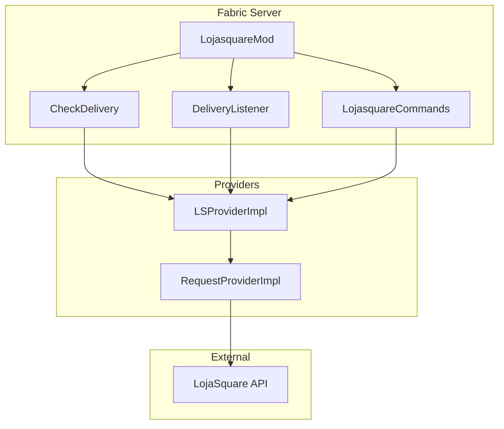
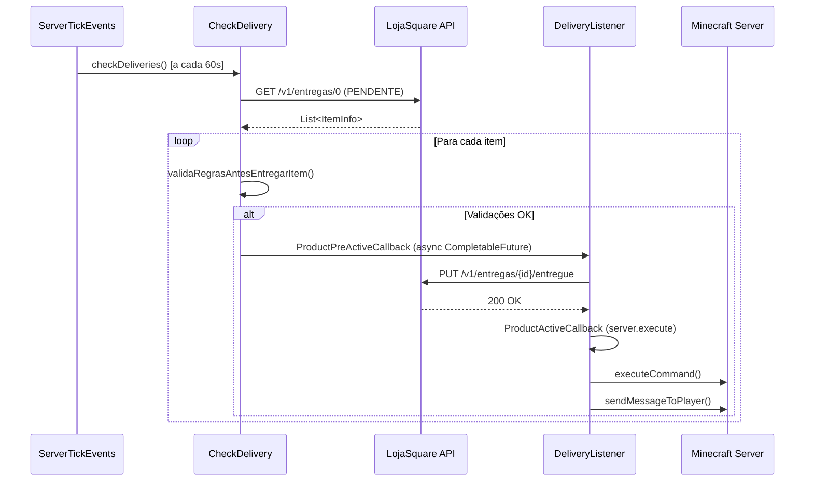

# LojaSquare - Mod Fabric

> Integração LojaSquare para entrega automática de produtos no Minecraft Fabric 1.21.1

[](https://www.oracle.com/java/)
[](https://fabricmc.net/)
[](https://lojasquare.com.br/)

---

## Sobre o Projeto

### Finalidade

Port do plugin **LojaSquare Bukkit/Spigot** (MC 1.16.4) para **Fabric** (MC 1.21.1). Preserva toda lógica de negócio original, adaptando apenas APIs específicas da plataforma.

### Funcionalidades

1. **Entrega Automática**: Monitora compras no site LojaSquare e entrega produtos no jogo
2. **Validação de Servidor**: Produtos entregues apenas no servidor correto
3. **Smart Delivery**: Entrega múltiplas unidades de uma vez (`@qnt` total)
4. **Auto-Configuração**: Cria configurações automaticamente para novos grupos
5. **Ativação de Conta**: `/lsite ativar <codigo>` para vincular conta do site
6. **Placeholders**: `@player`, `@produto`, `@grupo`, `@qnt`, `@dias`, `@money`, `@cupom`
7. **Validação de IP**: Verifica se o IP do servidor está autorizado na LojaSquare

---

## Arquitetura

### Estrutura de Pacotes

```
br.com.lojasquare/
├── LojasquareMod.java               # Classe principal (ModInitializer)
├── api/                              # Eventos custom Fabric
│   ├── ProductActiveCallback.java    # Callback ativação de produto
│   └── ProductPreActiveCallback.java # Callback pré-ativação
├── command/                          # Comandos Brigadier
│   └── LojasquareCommands.java      # /lsite
├── core/                             # Lógicas de negócio
│   ├── CheckService.java            # Interface serviço de checagem
│   ├── autoconfig/
│   │   └── CheckCreateGroupItem.java # Auto-criação config grupos
│   └── delivery/
│       └── CheckDelivery.java       # Verificação periódica de entregas
├── listener/                         # Handlers de eventos
│   └── DeliveryListener.java        # Processa entrega de produtos
├── providers/                        # Camada de integração
│   ├── lojasquare/
│   │   ├── ILSProvider.java         # Interface API LojaSquare
│   │   └── impl/
│   │       └── LSProviderImpl.java  # Implementação
│   └── request/
│       ├── IRequestProvider.java    # Interface HTTP
│       └── impl/
│           └── RequestProviderImpl.java # HTTPS client
└── utils/                            # Utilitários
    ├── ConfigManager.java           # Gerenciador YAML (SnakeYAML)
    ├── DateDuration.java            # Medidor de tempo
    ├── HttpResponse.java            # DTO resposta HTTP
    ├── SiteUtil.java                # Config conexão API
    ├── PluginLoadUtil.java          # Load de arquivos
    ├── TestCall.java                # Teste de conexão
    ├── enums/
    │   ├── LSEntregaStatus.java     # Status de entrega
    │   └── LSResponseEnum.java      # Códigos de resposta
    └── model/
        ├── ItemInfo.java            # DTO item/entrega
        ├── ProdutoInfo.java         # DTO produto
        └── ValidaIpInfo.java        # DTO validação IP
```

### Diagrama de Componentes



---

## Chamadas Externas à API

### 1. GET /v1/entregas/{status}

Busca entregas pendentes.

```java
GET https://api.lojasquare.net/v1/entregas/0?status=0
```

**Autenticação**: Header `Authorization` com SECRET_API
**Retorno**: `List<ItemInfo>`

---

### 2. GET /v1/produtos

Lista produtos da loja.

```java
GET https://api.lojasquare.net/v1/produtos?tokenSubServidor=TOKEN
```

**Uso**: Auto-configuração de novos grupos.

---

### 3. PUT /v1/entregas/{id}/entregue

Marca entrega como concluída.

```java
PUT https://api.lojasquare.net/v1/entregas/12345/entregue
```

**Fluxo**: Chamado **antes** de executar comandos (evita duplicação).

---

### 4. PUT /v1/clientes/activate

Ativa conta de usuário.

```java
PUT https://api.lojasquare.net/v1/clientes/activate?codigo=ABC123&usuario=PlayerName
```

**Comando**: `/lsite ativar <codigo>`

---

### 5. GET /v1/sites/extensoes

Valida IP do servidor.

```java
GET https://api.lojasquare.net/v1/sites/extensoes
```

**Autenticação**: Header `Authorization`

---

## Lógicas de Negócio

### 7 Validações em CheckDelivery

1. **Item não pode ser null**
2. **Status não pode ser ENTREGUE** (statusID=2)
3. **Servidor deve corresponder** (`config.yml` → `LojaSquare.Servidor`)
4. **Grupo configurado e ativado** (`produtos.yml` → `Grupos.<nome>.Ativado`)
5. **Player online** (exceto se `Ativar_Com_Player_Offline=true` ou grupos `DISPUTA`/`RESOLVIDO`)
6. **Inventário vazio** (se `Entregar_Apenas_Com_Inventario_Vazio=true`)
7. **Nick compatível** (case-insensitive)

### Smart Delivery

- `true`: Executa comandos 1x com quantidade total (`@qnt` * unidades)
- `false`: Executa comandos Nx (uma por unidade)

---

## Sistema de Eventos

### Eventos Custom Fabric

Usa `EventFactory.createArrayBacked` do Fabric API (padrão Observer).

#### ProductPreActiveCallback

**Disparado**: Antes de marcar entrega como concluída na API
**Cancelável**: `ActionResult.PASS` = prossegue, `ActionResult.FAIL` = cancela

```java
@FunctionalInterface
public interface ProductPreActiveCallback {
    Event<ProductPreActiveCallback> EVENT = EventFactory.createArrayBacked(...);
    ActionResult onPreActive(ServerPlayerEntity player, ItemInfo item);
}
```

#### ProductActiveCallback

**Disparado**: Após confirmação da API (entrega marcada como concluída)

```java
@FunctionalInterface
public interface ProductActiveCallback {
    Event<ProductActiveCallback> EVENT = EventFactory.createArrayBacked(...);
    ActionResult onActive(ServerPlayerEntity player, ItemInfo item);
}
```

### Registro

```java
ProductPreActiveCallback.EVENT.register(this::preActive);
ProductActiveCallback.EVENT.register(this::activeDelivery);
```

---

## Fluxo de Ativação/Entrega



---

## Design Patterns

| Pattern | Onde | Benefício |
|---------|------|-----------|
| **Strategy** | `CheckService` interface + `CheckDelivery`/`CheckCreateGroupItem` | Novas checagens sem modificar `LojasquareMod` |
| **Provider** | `ILSProvider` + `IRequestProvider` | Abstrai API/HTTP, facilita mocks |
| **Observer** | `ProductPreActiveCallback`/`ProductActiveCallback` (Fabric Events) | Desacoplamento entre detecção e processamento |
| **Singleton** | `LojasquareMod.getInstance()` | Acesso global ao mod |

---

## Auto-Configuração

### CheckCreateGroupItem

No `onInitialize()`, busca produtos no site e cria configuração padrão para grupos novos:

```yaml
Grupos:
  NomeDoGrupo:
    Ativado: false
    Ativar_Com_Player_Offline: false
    Enviar_Mensagem: false
    Mensagem_Receber_Ao_Ativar_Produto:
      - "&eOla &a@player"
      - "&eO produto que voce adquiriu (&a@produto&e) foi ativado!"
    Money: false
    Quantidade_De_Money: 0
    Cmds_A_Executar:
      - "gerarvip NomeDoGrupo @dias @qnt @player"
```

---

## Sistema de Delivery

### CheckDelivery

- **Timer**: `ServerTickEvents.START_SERVER_TICK` (a cada tick ≈ 50ms, filtro por segundos configuráveis)
- **Busca**: `GET /v1/entregas/0?status=0`
- **Valida**: 7 regras de negócio
- **Entrega**: Async via `CompletableFuture.runAsync`, comandos executados no `server.execute()`

### Placeholders

| Placeholder | Descrição |
|-------------|-----------|
| `@player` | Nome do jogador |
| `@produto` | Nome do produto |
| `@grupo` | Grupo do produto |
| `@qnt` | Quantidade |
| `@dias` | Dias do produto |
| `@money` | Valor monetário (double) |
| `@moneyInteiro` | Valor monetário (int) |
| `@cupom` | Código do cupom |

---

## Diferenças Bukkit/Spigot → Fabric

| Bukkit/Spigot | Fabric | Mudança |
|---------------|--------|---------|
| `onEnable()` | `onInitialize()` (ModInitializer) | Entrypoint |
| `plugin.yml` | `fabric.mod.json` | Metadados |
| `JavaPlugin` + `getDataFolder()` | `ModContainer` + `Path` manual | Config loading |
| `YamlConfiguration` | SnakeYAML (`ConfigManager`) | YAML parser |
| `@EventHandler` | `EventFactory.createArrayBacked` + `EVENT.register()` | Event system |
| `BukkitRunnable` | `ServerTickEvents` | Scheduler |
| `CommandExecutor` | Brigadier + `CommandRegistrationCallback` | Command system |
| `Bukkit.getServer()` | `MinecraftServer` via mod instance | Server access |
| `ConsoleCommandSender` | `LOGGER.info()` | Logging |

---

## Build

### Requisitos

- **Java**: 21+
- **Gradle**: 8.10 (wrapper incluso)

### Comandos

```bash
# Build
./gradlew build

# Output
ls build/libs/lojasquare-2.0.0.jar
```

### Dependências (embutidas no JAR)

- SnakeYAML 2.3 (config YAML)
- Fabric API 0.115.0+1.21.1 (runtime)
- Fabric Loader 0.16.9 (runtime)
- Lombok 1.18.32 (compile-only)

---

## Instalação

1. Instalar **Fabric Loader** 0.16.9 no servidor
2. Colocar **Fabric API** 0.115.0+1.21.1 em `mods/`
3. Copiar `lojasquare-2.0.0.jar` para `mods/`
4. Configurar `config/lojasquare/config.yml`:

```yaml
LojaSquare:
  SECRET_API: "sua-chave-aqui"
  Servidor: "Nome-Do-Servidor"
  Token_Servidor: "token-do-servidor"
  Connection_Timeout: 10000
  Read_Timeout: 10000
  Smart_Delivery: true
  Debug: true
Config:
  Tempo_Checar_Compras: 60
```

5. Ativar grupos em `config/lojasquare/produtos.yml`
6. Reiniciar servidor

### Estrutura em Produção

```
mods/
├── fabric-api-0.115.0+1.21.1.jar
├── fabric-loader-0.16.9.jar
└── lojasquare-2.0.0.jar
config/lojasquare/
├── config.yml       (criado automaticamente)
└── produtos.yml     (criado automaticamente)
```

---

## Comandos

| Comando | Descrição | Permissão |
|---------|-----------|-----------|
| `/lsite ativar <codigo>` | Ativa conta LojaSquare | `lojasquare.activate` |

---

## Segurança

- **SECRET_API**: Configurar apenas no `config.yml` do servidor. Nunca commitar.
- **HTTPS**: Todas as chamadas usam HTTPS com TrustManager que aceita certificados autoassinados.
- **Validação de IP**: Servidor só opera se IP estiver autorizado na plataforma.

---

## Licença

Projeto privado - **LojaSquare / TrowDev**.

---

## Contato

- **Website**: https://lojasquare.com.br
- **Email**: admin@lojasquare.com.br
